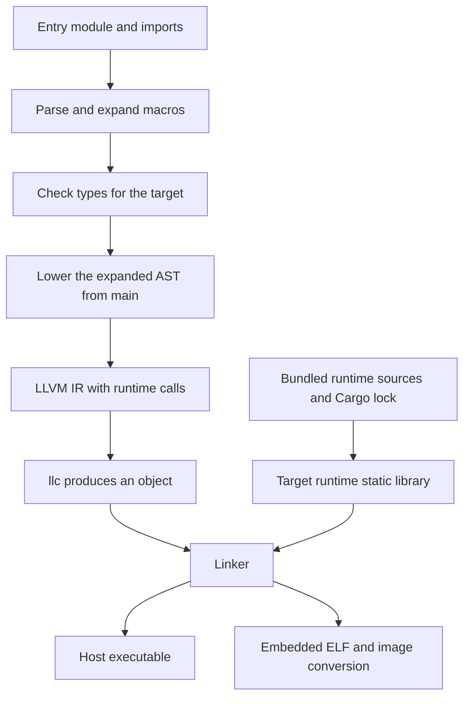

# From Prime source to a native executable



## Where specialization stops

`Compiler::compile_checked_program` accepts the expanded program together with the checker’s match facts, verifies its target, collects definitions and emits the entry point. A Prime call can resolve to a definition whose body the compiler walks with the supplied arguments. `EvaluatedValue` pairs the compiler's representation with optional runtime information. Known values can determine a branch or result during lowering. Operations on runtime data need LLVM instructions or calls in the emitted program. [Compiler entry and values](../src/language/compiler/mod.rs) · [Function resolution](../src/language/compiler/resolve.rs) · [Expression emission](../src/language/compiler/emit.rs)

For a concrete comparison, the channel demo always sums the same three integers. Equal output from both backends shows agreement for that input. The web-server regression builds **once**, then sends different requests to the same executable and checks distinct HTTP responses. That exercises behavior which depends on input received after compilation. The compiler's separate snapshot evaluator is used by the experimental parallel build path for `spawn`. A successful build alone establishes neither scheduling nor interleaving at execution time. [Web regression](../scripts/test_web_server.py) · [Build evaluator](../src/language/build.rs) · [Async contract](AsyncAwait.md)

## Inspect a host build

From the repository root:

```sh
prime-lang build workspace/demos/channel_demo/channel_demo.prime --name channel_demo
./.build.prime/channel_demo/channel_demo
```

The host artifact directory contains `channel_demo.ll`, `channel_demo.o` and the executable. The IR shows which operations survived specialization. Declarations of `prime_*` symbols describe available functions. Look for a **call** in a function body to find a use. For example, a compiled loopback server calls into the TCP runtime when it accepts a connection. [LLVM declarations](../src/language/runtime_abi.rs) · [Rust exports](../src/runtime/abi.rs)

The CLI compiles the matching runtime archive and links it with the object. For a target triple the artifact directory includes the triple. Xtensa ESP32 and RV32IMC ESP32-C3 require target-specific tools, startup and linker scripts. Use `--no-flash` for build verification. The board acceptance procedure checks boot, UART and GPIO separately. [Embedded pipeline](EmbeddedPipeline.md) · [Board testing](BoardTesting.md)
