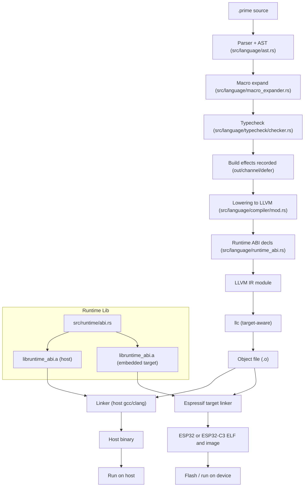

# Prime Compiler Flow (Detailed)

This diagram traces a build from parsed AST through LLVM IR to the linked binary, highlighting where type info, effects, and ABI calls are applied.

Host builds link the bundled Rust runtime for graphics, audio, channels and tasks. Embedded builds link a `no_std` runtime with fixed-capacity storage. Classic ESP32 uses Espressif LLVM and Xtensa tools. ESP32-C3 uses RV32IMC LLVM code and the ILP32 ABI. The link step uses the selected target's startup and memory layout. [Embedded pipeline](EmbeddedPipeline.md)

Host async blocks run on worker threads. Embedded async blocks use deferred evaluation. On both targets, timer and receive tasks can be polled for completion. [Task semantics](AsyncAwait.md)

Nonconstant integer and float comparisons emit LLVM `icmp` and `fcmp` instructions. Their boolean results can drive native control flow.
