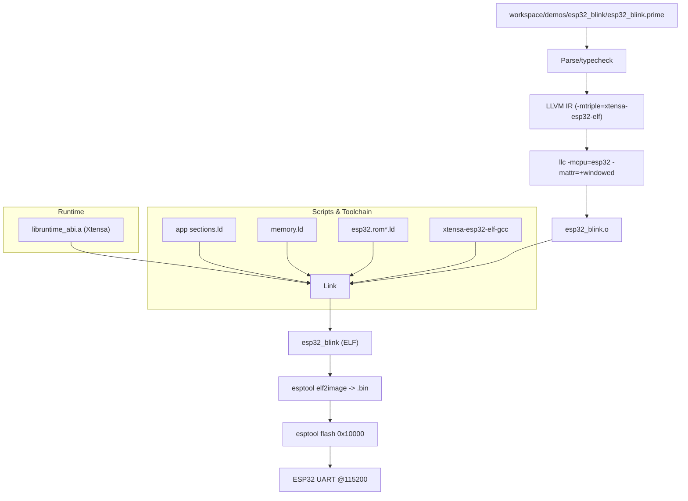

# Embedded Build & Flash Pipeline

End-to-end view for the ESP32 blink demo, including toolchains, scripts, and flashing.

## Classic ESP32

The blink and bare-metal demos supply target settings in their manifests. Xtensa LLVM emits static objects with the ESP32 windowed ABI. The linker combines the object, the runtime, the IDF memory scripts, libc and libgcc. The runtime supplies the classic ESP32 entry point. See the [build instructions](../README.md#embedded--esp32-xtensa-quickstart).

The embedded runtime uses fixed-capacity channels and tasks. Runtime limits in `build.runtime` configure capacity and polling. Filesystem operations use the host runtime. Xtensa GPIO, clock setup, watchdog handling and UART output use board-specific code.

## Verifying a change

The host interpreter can run the [no_std parity fixture](../workspace/demos/no_std_parity/main.prime) for reference output. A cross-build exercises LLVM, linking and packaging. The [RV32 timer suite](EmbeddedTimers.md) executes compiled ABI calls with controlled clock input. Final board checks cover boot, serial output, GPIO and timing under load. For wait result ordering and current lowering limits see the [async specification](AsyncAwait.md).

## ESP32-C3 builds

Install the stable Rust target with `rustup target add riscv32imc-unknown-none-elf`. Use an RV32IMC C linker and supply a C3 linker script (`build.toolchain.ld_script`) and any required startup object (`build.toolchain.startup_obj`). The script selects the entry point. Prime uses an LLVM RISC-V triple with the M and C extensions and links with the ILP32 ABI. Xtensa uses its own startup symbol and Espressif Rust toolchain.

For flashing, Prime requires a successful `esptool elf2image` conversion. During a no-flash build a configured objcopy can produce a raw binary if conversion fails. The CLI reports that fallback. The [embedded timers document](EmbeddedTimers.md) describes emulator coverage and outstanding board-specific checks.
