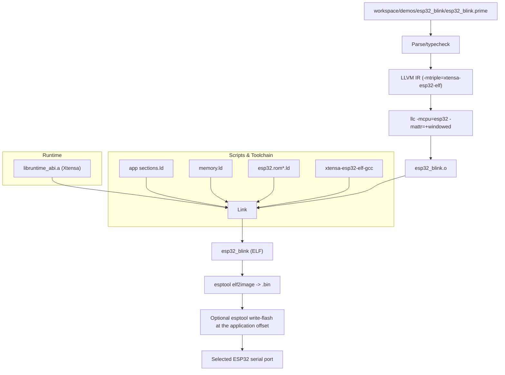

# Embedded Build & Flash Pipeline

End-to-end view for the ESP32 blink demo, including toolchains, scripts, and flashing.



## Classic ESP32

The blink and bare-metal demos supply target settings in their manifests. Xtensa LLVM emits static objects with the ESP32 windowed ABI. The linker combines the object, the runtime, the IDF memory scripts, libc and libgcc. The runtime supplies the classic ESP32 entry point. See the [build instructions](../README.md#embedded--esp32-xtensa-quickstart).

The embedded runtime uses fixed-capacity channels and tasks. Runtime limits in `build.runtime` configure capacity and polling. Filesystem operations use the host runtime. Xtensa GPIO, clock setup, watchdog handling and UART output use board-specific code.

## Verifying a change

The host interpreter can run the [no_std parity fixture](../workspace/demos/no_std_parity/main.prime) for reference output. A cross-build exercises LLVM, linking and packaging. The [RV32 timer suite](EmbeddedTimers.md) executes compiled ABI calls with controlled clock input. Final board checks cover boot, serial output, GPIO and timing under load. For wait result ordering and current lowering limits see the [async specification](AsyncAwait.md).

## ESP32-C3 builds

Install the stable Rust target with `rustup target add riscv32imc-unknown-none-elf`. Use an RV32IMC C linker and supply a C3 linker script (`build.toolchain.ld_script`) and any required startup object (`build.toolchain.startup_obj`). The script selects the entry point. Prime uses an LLVM RISC-V triple with the M and C extensions and links with the ILP32 ABI. Xtensa uses its own startup symbol and Espressif Rust toolchain.

## Flashing an application

With `build.flash.enabled = true`, Prime writes the application image produced by this build's successful `elf2image` conversion. The board must already have a compatible bootloader and partition table for an application-only update. Set `build.flash.address` to the start of the intended application partition. It defaults to `"0x10000"` and accepts a hexadecimal or decimal byte offset aligned to 64 KiB. The image must fit the partition and the board's flash. Prime rejects a zero or misaligned offset and writes extending beyond esptool's 16 MiB address range for these targets. [ESP-IDF partition layout](https://docs.espressif.com/projects/esp-idf/en/stable/esp32c3/api-guides/partition-tables.html#offset-size) · [esptool flash addressing](https://docs.espressif.com/projects/esptool/en/latest/esp32/troubleshooting.html#flash-and-external-memory-support-limitations)

Prime takes the serial port from `build.flash.port`, then `PRIME_ESP_PORT`. When both are unset it omits `--port`, so esptool uses `ESPTOOL_PORT` or searches connected ports. The checked-in blink manifest sets `port` explicitly. The baud rate comes from `build.flash.baud`, then `PRIME_ESP_BAUD`, and defaults to 460800. The esptool executable comes from `PRIME_ESPTOOL`, then `build.toolchain.esptool`, and defaults to `esptool` on PATH. [esptool serial options](https://docs.espressif.com/projects/esptool/en/latest/esp32/esptool/basic-options.html)

Image conversion uses the short options shared by esptool 4 and 5. Flashing uses the esptool 5 command `write-flash`. For a C3 with default image settings and an explicitly selected port, the commands are as follows (artifact paths abbreviated).

```text
esptool --chip esp32c3 elf2image -fm dio -ff 40m -fs 4MB -o app.bin app
esptool --chip esp32c3 --port PORT --baud 460800 write-flash -z 0x10000 app.bin
```

To provision components along with the application, supply the binary paths explicitly. Either variable can be used independently. Relative paths resolve against the directory where you run `prime-lang build`. Use binaries built for the same chip and partition layout as the application. Prime uses these offsets for the standard ESP-IDF layout. [Classic ESP32 boot offset](https://docs.espressif.com/projects/esptool/en/latest/esp32/esptool/flash-modes.html) · [ESP32-C3 flash layout](https://docs.espressif.com/projects/esptool/en/latest/esp32c3/esptool/flashing-firmware.html)

| Optional image | Environment variable | Classic ESP32 | ESP32-C3 |
| --- | --- | --- | --- |
| Bootloader | `PRIME_ESP_BOOTLOADER` | `0x1000` | `0x0` |
| Partition table | `PRIME_ESP_PARTITIONS` | `0x8000` | `0x8000` |

Prime checks that each supplied path names a readable, nonempty regular file before starting `write-flash`. The bootloader must fit below the table at `0x8000` and the table must fit its 4 KiB sector. A board with a custom table offset requires its own provisioning layout.

For build verification, pass `--no-flash`. It overrides an enabled manifest, skips serial port selection and component checks, and still runs the offline image conversion. If conversion fails, a configured objcopy can produce a raw binary for inspection. Only successful esptool conversion produces a candidate for flashing. Board boot and runtime checks are separate from packaging. [Embedded timer verification](EmbeddedTimers.md)

## ESP-IDF component linking

An SDK project can use `prime-lang build TARGET --emit-object FILE --no-flash` to generate a relocatable object and link it through its own build system. The classic ESP32 socket example runs the generated Prime entry under FreeRTOS and exchanges binary TCP and UDP payloads through lwIP loopback. [SDK build, firmware images and UART verification](EspIdfSockets.md)
