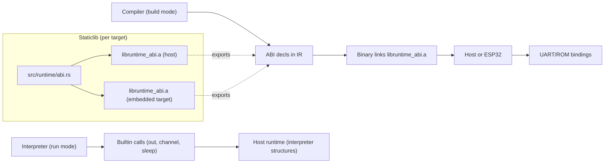

# Runtime & FFI Surfaces

How the interpreter, compiler, and runtime ABI interact across the host, ESP32 and ESP32-C3 targets.



The interpreter uses an in-process runtime. Native code calls C-compatible symbols declared in `src/language/runtime_abi.rs` and implemented in `src/runtime/abi.rs`, `graphics_abi.rs` and `audio_abi.rs`. The CLI ships these implementations with the matching Cargo lockfiles. Changing a parameter's type or width requires updating both sides and exercising the generated call on the target.

| Call | Argument | Return |
| --- | --- | --- |
| `prime_integer_check` | Boolean condition, pointer to UTF-8 diagnostic bytes, target-width byte length | Returns on success. On failure the host reports the error and exits, and firmware stops. |
| `prime_sleep_task` | `i128` milliseconds | Opaque task handle |
| `prime_result_new` (host) | Payload handle, selected variant tag and declared Ok tag (both `u32`) | Result handle containing a copy of the payload and the corresponding display label |
| `prime_delay_ms` | `i32` milliseconds | `PrimeStatus` |
| `prime_recv_timeout` | Receiver handle, `i128` milliseconds, output pointer | `PrimeStatus` |

Native `?` reads the variant with `prime_enum_tag`. Only the success edge calls `prime_enum_get(handle, 0)` for the payload. Tuples inside a Result use positional enum records. Struct records use field-name order, the same representation used for task results. A nested Result retains its own tag and payload handle. The embedded enum ABI stores one payload per record.

The host runtime uses OS threads. The embedded runtime uses statically initialized pools and a target-specific clock. Closing a channel preserves its queued values. After those values have been read, the channel releases its slot. [Embedded timers and channels](EmbeddedTimers.md)

Host interpreter and async errors can propagate through task results. The embedded runtime aborts or loops on panic. [Async semantics and restrictions](AsyncAwait.md)

## Host runtime selection

After LLVM emits the object, `prime-lang build` inspects its undefined symbols. References to `prime_gfx_*` enable graphics and references to `prime_audio_*` enable audio. Both are enabled for Tetris. An unused declaration or a string containing a symbol name adds no dependency. A function whose body is present in the object can require media even if the program never calls it.

The base runtime has a dependency-free Cargo manifest and lockfile. It provides text, core operations, filesystem and TCP. The three media combinations enable their respective Cargo features. Linux links ALSA for the combinations with audio. File and stdin builds use the same selection.

The CLI carries the sources and locks when moved away from the repository. Each runtime combination has a separate Cargo target directory and build lock under `$CARGO_TARGET_DIR/prime-runtime`, or `.build.prime/runtime` when the variable is unset. Two builds of the same combination share the cache and hold its lock through native linking. Builds using different combinations can run concurrently.

On x86-64 Arch Linux with Rust 1.100.0, LLVM 23.1.3 and two Cargo build jobs, the same `out("hello");` input to `prime-lang build - --name hello` gave the following elapsed times. Each cold run started with empty build and target directories and a populated Cargo registry. Warm times are the median of five subsequent builds. CLI installation time is excluded.

| Host runtime | Cold build | Warm build |
| --- | ---: | ---: |
| Full runtime for every program (7a09ff2) | 42.999 s | 0.090 s |
| Automatically selected minimal runtime | 0.842 s | 0.051 s |

## ESP32-C3 strings

On RV32IMC, `prime_string_new(data, len)` copies exactly `len` bytes into immutable storage. Identical byte sequences share a handle, even after the pool fills. The pool holds 64 distinct strings and 8192 payload bytes in total per boot. An empty string uses one handle and zero bytes. A null input pointer, an oversized string, or a new value that exceeds either limit returns a null handle. Existing values stay readable, including through a channel, task or enum payload. Embedded handle release currently provides no last-owner signal for reclaiming strings.

`prime_value_as_string(handle, &ptr, &len)` returns `Ok` with a borrowed pointer and byte length for a C3 string. Callers must use that length. Embedded zero bytes are preserved. `prime_int_to_string` formats signed 128-bit integers in decimal and uses the same pool.

The standalone regression requires Rust's `riscv32imc-unknown-none-elf` target, LLVM tools (`llc`, `llvm-nm`, `llvm-objcopy`), and Python Unicorn 2.1.4. With `riscv32-esp-elf-gcc` on PATH it uses the Espressif driver. Ubuntu x86 CI uses Clang 21 and LLD 21 instead. Clang assembles the startup object and drives the RV32IMC link with `-nodefaultlibs`. The Rust runtime archive supplies the memory and arithmetic builtins. The probe executes the ELF and also works without esptool via the CLI's raw objcopy output.

From the project root, with the selected LLVM bin directory on PATH, run

```sh
cargo build --locked --bin prime-lang
PRIME_BIN="$PWD/target/debug/prime-lang" python3 scripts/test_c3_strings.py -v
```

The probe runs the Prime interpreter and builds the fixture through `prime-lang build main.prime --name c3 --no-flash`. Unicorn executes the linked RV32IMC application twice. The test reads the handles passed to `prime_print` through the linked ABI and compares their bytes with interpreter output, including a closed channel yielding `Err("empty")` and a task returning UTF-8 text. Separate probes exercise pool exhaustion, repeated lookups and decimal formatting. This checks the print boundary in emulation. Physical UART output and board boot require separate verification.

The same RV32IMC suite runs integer programs through the interpreter and CLI-built firmware in Unicorn. It checks adjacent wide integers, 32-bit pointer-sized casts, boolean output, and out-of-range arguments at a user function boundary. On RV32 the failed guard receives the diagnostic bytes and executes a breakpoint. The suite observes the guest ABI and CPU exception without board I/O.
