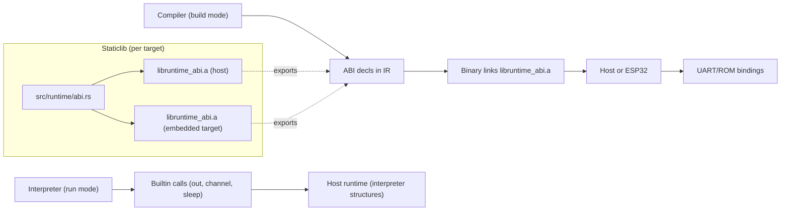

# Runtime & FFI Surfaces

How the interpreter, compiler, and runtime ABI interact across the host, ESP32 and ESP32-C3 targets.

The interpreter uses an in-process runtime. Native code calls C-compatible symbols declared in `src/language/runtime_abi.rs` and implemented in `src/runtime/abi.rs`. The CLI ships these implementations with the matching Cargo lockfiles. Changing a parameter's type or width requires updating both sides and exercising the generated call on the target.

| Call | Argument | Return |
| --- | --- | --- |
| `prime_sleep_task` | `i128` milliseconds | Opaque task handle |
| `prime_delay_ms` | `i32` milliseconds | `PrimeStatus` |
| `prime_recv_timeout` | Receiver handle, `i128` milliseconds, output pointer | `PrimeStatus` |

The host runtime uses OS threads. The embedded runtime uses statically initialized pools and a target-specific clock. Closing a channel preserves its queued values. After those values have been read, the channel releases its slot. [Embedded timers and channels](EmbeddedTimers.md)

Host interpreter and async errors can propagate through task results. The embedded runtime aborts or loops on panic. [Async semantics and restrictions](AsyncAwait.md)
