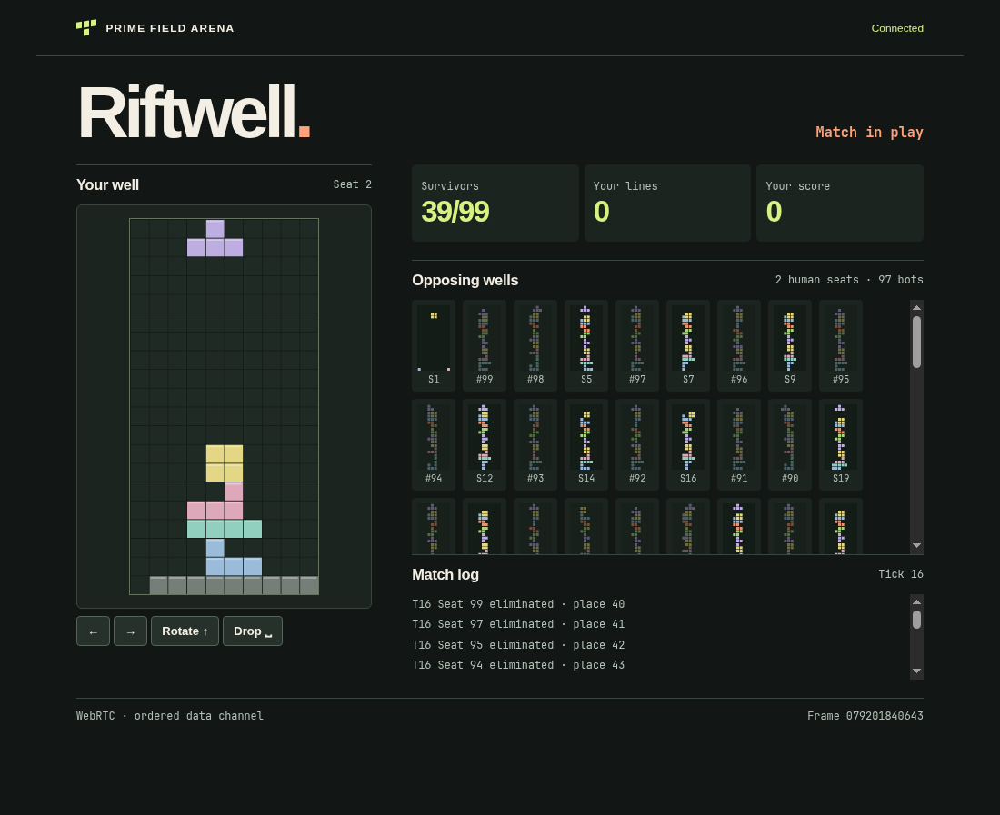

# Riftwell

Riftwell is a local browser arena for 2–99 falling-block wells. Each match runs one Prime ECS process. It owns gravity, the bag, collision, locking, garbage, elimination and final places. The browser paints its output and sends numbered keypresses. The same lobby accepts WebSocket and WebRTC players.



## Run locally

From the repository root, activate a Python 3.11+ virtual environment with the WebSocket SDK and put `prime-lang` on PATH (or set `PRIME_BIN` to its executable). The launcher starts a native Prime match over WebSocket. Add `--webrtc` to enable both transports with Go 1.24+ installed. Add `--interpret` to use the Prime interpreter.

```sh
python3 -m venv /tmp/riftwell-venv
. /tmp/riftwell-venv/bin/activate
pip install -r sdk/websocket/requirements.txt
./scripts/play_riftwell.sh --webrtc --seats 99 --humans 2
```

### Explicit build and launch

For direct control over the binaries, use the repository Rust/LLVM toolchain and the same activated environment. The arena binds loopback and creates a private temporary Unix socket per adapter.

```sh
arena=workspace/demos/field_arena
(cd adapters/webrtc && go build -mod=readonly -o /tmp/riftwell-rtc .)
```

Build the checked-out CLI and choose the ECS executable. These commands start a mixed-transport match in the interpreter.

```sh
export CARGO_BUILD_JOBS=2
cargo build --locked --bin prime-lang
cli="$(realpath "${CARGO_TARGET_DIR:-target}/debug/prime-lang")"
entry=workspace/demos/tetris_arena/main.prime
python "$arena/arena.py" --ws-service sdk/websocket/service.py --rtc-bin /tmp/riftwell-rtc \
  --seats 8 --humans 2 --port 8000 -- "$cli" run "$entry"
```

To run it natively, stop the match, run `"$cli" build "$entry" --name riftwell`, and use `-- ./.build.prime/riftwell/riftwell` as the engine command.

Open the printed URL in one tab for WebSocket. In another tab or browser, open the same URL with `/?transport=rtc`. Select **Start match**. Left and right arrows move, up rotates and space drops. On-screen controls also work. Refresh the tab to resume its reserved seat. State and resumable identities last for one server process. A new tab without an identity claims a new human seat. After all reserved human seats are claimed, another fresh identity receives a lobby-full message.

The server assigns human seats in connection order and fills the other seats with deterministic bot inputs. `--seats 99 --humans 2` reserves two human seats and runs 97 simulated opponents. Set `--humans` equal to `--seats` to reserve all seats for players. The launcher sets the WebSocket adapter cap to the human-seat count. The RTC adapter admits up to 99 concurrent peers. Both adapters feed the same roster. Each process can start with only `--ws-service` or only `--rtc-bin`. The RTC option uses the SDK's own browser helper and loopback signaling endpoint through the same page origin.

## Session and snapshots

Both SDKs deliver three lines per peer event (kind, peer ID, payload) and accept `text PEER PAYLOAD` addressed replies. The local relay only moves bytes between the SDK child interface and the arena. Peer identity is the pair of adapter name and SDK peer ID. A browser sends `join UUID zlib` when it supports DEFLATE. A plain-text client can send `join UUID`. Both send `move SEQUENCE ACTION`, with action 0 for an explicit wait and 1–4 for the movement controls. The peer binding determines the seat. Sequences start at one. The server acknowledges a move in the authoritative tick where Prime consumes it. An old or queued sequence returns the current snapshot. Gaps and concurrent claims on an active identity are rejected. The browser keeps its random bearer token and unacknowledged inputs in tab session storage.

Each complete snapshot carries every seat's visible board, score, lines, life flag, placement and acknowledged sequence, along with the match tick, winner and events. The server serializes a complete snapshot once per broadcast and shares its encoded chunks across recipients. `F PART COUNT SHA256 TEXT` carries plain JSON. `Z PART COUNT SHA256 TEXT` carries base64 of the zlib-compressed JSON when the negotiated representation is smaller. Both use zero-based parts of at most 2800 ASCII payload bytes. Reassemble all parts before decoding. Verify SHA-256 over the original JSON bytes before replacing the displayed state. A reconnect always gets a complete snapshot, including the acknowledged input sequence. The browser paints the four projected active cells and the 200 settled cells from Prime.

The default server waits 250 ms between ticks. With `--tick-ms 0`, each accepted input advances one tick. With `--lockstep` in an all-human roster, the server waits for one numbered move or wait from every live seat, then commits them together in seat order. A disconnected live seat can resume and submit its move. Wall-clock mode continues advancing while a player is offline.

## System checks

The browser check requires Chromium and the matching chromedriver on PATH. Install the SDK test requirements to obtain Selenium. It launches two separate Chromium processes per backend, negotiates a real WS and a real ordered RTC data channel into the same match, verifies snapshots, sends different keyboard moves, reloads a tab, checks a duplicate after reconnect, receives a garbage attack, plays through elimination to one survivor and saves a real browser screenshot. Its default roster is 99. The replay check drives 99 simulated seats with recorded action vectors and compares both ECS transcripts and all placements. The WS check also disconnects with an unacknowledged input while the real clock runs, reconnects and verifies the resulting position on both backends.

```sh
pip install -r sdk/websocket/requirements-test.txt
"$cli" build "$entry" --name riftwell
native="$PWD/.build.prime/riftwell/riftwell"
python "$arena/test_browser.py" --ws-service sdk/websocket/service.py --rtc-bin /tmp/riftwell-rtc \
  --prime "$cli" --entry "$entry" --native "$native" --screenshot /tmp/riftwell.png
python "$arena/test_replay.py" --prime "$cli" --entry "$entry" --native "$native" --replay /tmp/riftwell.json
```

The Linux full-roster test starts `scripts/play_riftwell.sh` in both interpreter and native mode. It needs only the WebSocket runtime dependency and the CLI. It creates 99 real WS connections, sends hard drops from seats 1–98 and a numbered wait from seat 99 each tick, and verifies the decoded snapshots, input acknowledgements and all places on all 99 clients. For CI, use the command below with `PRIME_BIN` pointing to the built CLI. Append `--compare-plain` to measure the plain wire format on both backends with identical inputs.

```sh
PRIME_BIN="$cli" python workspace/demos/field_arena/test_roster.py
```

### Recorded run

| Scenario on archiebald x86-64 | Result in the interpreter and native binary |
| --- | --- |
| Two Chromium 155 processes, one WS peer, one RTC peer and 97 bots | The browsers agreed on all 22 played ticks, including the seat-1 attack on tick 12, 98 eliminations and seat 1 winning. Final snapshot SHA-256 `42a84059ebf1f908ff848e67e38b274a6fe9fd59b427cdb4256908aab1a5d062`. |
| 99 deterministic bot input streams, zero transport connections and zero browser windows | 19 ticks, one attack, 98 eliminations, seat 1 winning. The complete ordered transcript including input acknowledgements and snapshots had SHA-256 `2caf8e759264c75d23722a9c008483dcb9490201589708e51f433f6021697bc5`. The [recorded replay](bots.replay.json) contains every input, event and placement. |
| Timed disconnect and resume, one WS client | The original seat recovered after disconnecting with pending input. Duplicate move 1 and subsequent move 2 produced two acknowledged inputs and the expected piece position. |
| 99 simultaneously connected WS clients, zero simulated bots and zero browser windows | Each connection claimed a distinct seat. The input from seat 99 changed only its own well and all 99 recipients agreed on the resulting snapshot. |
| Full match with 99 automated WS clients, zero simulated slots and zero browser windows | All clients reconstructed the same state on every tick. Seat 99 won on tick 10 and seats 1 through 99 placed 99th through first. The final snapshot SHA-256 was `dd9e188c63e410a64633b438737161a634b49c8fb2d36ccb7f3aaf4bbfa59960`. |

#### Full-match traffic and timing

The [measured run](roster99-run.txt) used the debug Prime CLI at `e087738` on archiebald x86-64. Each tick was timed from input submission through all 99 clients decoding, hashing and comparing the authoritative snapshot. There was no timer delay between ticks. TX and RX sum the 99 clients’ Linux TCP payload counters, including WebSocket headers, masking and control frames. The play interval begins after all clients receive the start snapshot and ends at victory. The log also includes connection setup and lobby traffic in the through-final counters. TCP/IP and link-layer headers and connection teardown fall outside the measurement. The 98 identical hard-drop streams produced many repeated boards, which compress well.

| Backend and snapshot | Match duration | Mean tick | Client TX bytes | Client RX bytes |
| --- | ---: | ---: | ---: | ---: |
| Native, plain | 0.322 s | 32.24 ms | 13,959 | 21,986,613 |
| Native, compressed | 0.222 s | 22.17 ms | 13,959 | 657,558 |
| Interpreter, plain | 29.319 s | 2,931.91 ms | 14,949 | 21,987,207 |
| Interpreter, compressed | 28.912 s | 2,891.23 ms | 14,949 | 658,152 |

Compression reduced native downstream traffic by 97.0% for this roster. The four runs produced identical tick hashes and standings.
